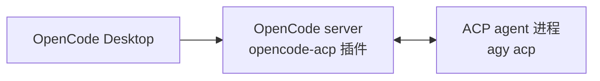

# opencode-acp

把外部 ACP agent 接入 OpenCode Desktop。选中对应的 ACP 模型后，每条消息都交给 agent 在自己的进程里执行；OpenCode 负责显示对话、思考、工具卡片、diff 和审批，并保留会话历史。

当前可用的是 Antigravity CLI（`agy acp`）。Codex 预留了 `acp-codex` 配置项，但尚未实现：它不会注册模型，也不会启动进程。



## 功能

- 模型选择器列出 agent 通过 ACP 报告的全部模型（`agy` 为 11 个 Gemini / Claude / GPT-OSS 模型），选中后整轮对话由该模型执行。
- 每个模型带 thinking level 二级选择（如 Low / Medium / High / Extra），与 agent 的 `thought_level` 一一对应。
- 正文和思考按流式输出。
- 远端工具调用显示为 OpenCode 原生卡片：`bash`、`read` / `list`、`grep` / `glob`、`edit` / `write`（带 diff）、`webfetch`，其他工具使用 `acp_<name>` 通用卡。OpenCode 只渲染这些卡片，不会重复执行命令或修改文件。
- 审批使用原生权限卡片，可以允许一次、始终允许或拒绝。
- 会话映射保存在插件 storage 中。OpenCode server 重启后，下一轮通过 `session/load` 恢复远端上下文。
- ACP 会话标题会成为 OpenCode 标题；token 统计包含 cache 和 reasoning；上下文窗口从 agent 的 `usage_update` 学习。
- 桌面端设置页展示 agent 配置、CLI 检测、默认模型、模型列表、上下文窗口、进程状态和日志级别。

## 前置条件

- OpenCode Desktop。插件在 server 端运行，但设置页是 Desktop 功能；web 端只在 Settings › Extensions 中列出插件，不显示插件页面。
- 已安装 Antigravity CLI，`agy` 在 `PATH` 中，并已在终端完成一次登录。
- 如果当前网络访问模型目录需要代理，准备好代理地址，在 agent 配置的 `env` 中传入。
- 当前实现基于 `@opencode/plugin` 2.4.1，并在同版本 OpenCode Desktop 上验证。

## 安装

插件目前以本地目录方式加载，没有发布到 npm。获取源码后，在插件目录（例如 `~/.config/opencode/plugins/opencode-acp`，也就是包含 `package.json` 的目录）安装依赖并构建 Desktop 设置页：

```bash
pnpm install --frozen-lockfile
pnpm build
```

OpenCode 会自动发现 `~/.config/opencode/plugins/` 下的插件目录。插件放在其他位置，或需要传入 `options`（例如为 `agy` 配置代理）时，在 `opencode.json` 或 `opencode.jsonc` 的 `plugins` 中加入：

```jsonc
{
  "plugins": [
    {
      "package": "/absolute/path/to/opencode-acp",
      "options": {
        "agents": [
          {
            "id": "acp-agy",
            "env": {
              "HTTPS_PROXY": "http://127.0.0.1:7890",
              "HTTP_PROXY": "http://127.0.0.1:7890"
            }
          }
        ]
      }
    }
  ]
}
```

`package` 建议写绝对路径。上面的 `env` 只在需要代理时添加，请替换成实际代理地址。

安装依赖并保存配置后，在 OpenCode 中执行 `/reload`。插件加载成功后会通过 `agy acp` 采集模型列表，首次查询完成时选择器会自动刷新。之后选择 Antigravity 下的任意模型即可开始对话。如果模型没有出现，参考下方“故障排查”。

### 配置项

`options.agents` 是 agent 列表。不写时使用内置 preset：`acp-agy` 和 `acp-codex`。

每个 agent 支持以下字段：

| 字段      | 说明                                                                                                   |
| --------- | ------------------------------------------------------------------------------------------------------ |
| `id`      | provider ID，必须匹配 `^[a-z0-9][a-z0-9-]*$`。已知 ID 会继承 preset 的 `command`、`args`、`env` 和名称 |
| `command` | 要启动的可执行文件；自定义 agent 必须提供                                                              |
| `args`    | 启动参数，字符串数组                                                                                   |
| `env`     | 传给 agent 进程的环境变量，代理通常写在这里                                                            |
| `name`    | OpenCode 中显示的名称                                                                                  |
| `enabled` | 设为 `false` 时保留配置但不启动该 agent                                                                |

其他选项：

| 选项           | 说明                                                                                           |
| -------------- | ---------------------------------------------------------------------------------------------- |
| `logLevel`     | `silent`、`error`、`warn`、`info`（默认）或 `debug`。`silent` 仍会输出 warning                 |
| `contextLimit` | 正整数。覆盖写入模型目录的上下文窗口；不设置时由第一条 `usage_update` 决定，并重载一次模型目录 |

## 使用

1. 在模型选择器中选择一个模型，需要时在旁边的二级菜单中选择 thinking level。
2. 正常发送消息。只有最新一条用户消息的文本会转发给 agent；OpenCode 的系统提示、历史消息、图片附件和工具记录不会发送。
3. agent 自己决定调用哪些工具。工具卡和 diff 由 OpenCode 渲染，实际命令和文件操作在 agent 进程中执行。
4. 需要审批时会出现原生权限卡：
   - **允许一次**：只放行当前请求。
   - **始终允许**：放行当前请求，并把请求中的命令、路径或 URL 保存为项目级规则；之后完全相同的请求不再弹卡。包含 `*` 或 `?` 的资源不会写入规则。
   - **拒绝**：结束当前 step，工具显示为已停止，整轮对话显示为已中断。

   审批卡没有单独的“取消”按钮。从外部中断整个会话时，挂起的 ACP 请求会被回复为 `cancelled`，对话正常结束。
5. 点击停止会向 agent 发送 `session/cancel`，并结束当前流。

### 模型与 thinking level

- 模型列表和每个模型支持的 thinking level 来自 agent 的 `session/new` 响应。插件在启动后用一个短会话采集，采集完成后写入缓存并刷新模型目录。
- 模型列表保存在插件 storage，后续启动先显示缓存，再后台刷新。首次运行且离线时选择器可能暂时为空。
- 可以在对话中随时切换模型或 thinking level。插件在发送下一条消息前调用 `session/set_config_option`，ACP 会话保留上下文，已经生成的内容不受影响。
- 模型旁边的 “Default” 表示不指定 variant，插件会使用该模型在 agent 中的默认 thinking level。
- 旧版本插件创建的会话保存的是 `acp-agy/default`，升级后需要重新选择模型。

### 会话与标题

- 一个 agent 只启动一个进程，被所有使用它的 OpenCode 会话共享；插件卸载或 server 退出时结束。agent 运行在独立进程组中，关闭时会一并结束它 fork 的子进程。
- OpenCode 会话与 ACP 会话的映射保存在插件 storage。server 重启后，下一轮会调用 `session/load`；加载失败时会新建 ACP 会话，并在回复中说明上下文未恢复。
- agent 通过 `session_info_update` 报告的标题优先。如果 OpenCode 已经用首条消息生成了标题，ACP 标题到达后会替换它，除非用户手动重命名过会话。

### Token 与上下文

- prompt 响应中的 usage 会映射为 input / output、cache 和 reasoning token；如果 agent 只发送 `usage_update`，则使用其中的已用 token 作为输入。
- ACP 的累计 cost 不会换算成 OpenCode 的模型价格。
- 上下文窗口初始为 10,000,000，第一轮 `usage_update.size` 到达后更新为 agent 报告的值（`agy` 约为 1,048,576）。可以用 `contextLimit` 强制覆盖。

## 设置页

打开 Settings › ACP agent，可以看到：

- 每个已配置 agent 的状态：可用、未安装、已禁用或暂未接入。
- CLI 的解析路径和 `--version` 输出。
- agent 的默认模型、完整模型列表和当前上下文窗口。
- agent 进程是否运行、PID，以及最近一次启动失败原因。
- 插件的日志级别和上下文覆盖值。

页面数据来自当前实际加载插件的 server。刷新按钮会重新读取。

## 限制

- Codex 接入尚未实现，`acp-codex` 不会提供模型。
- 模型目录需要开一个短会话向 agent 采集；agent 不支持 `session/close` 时，会在 agent 侧留下一个空会话。
- 只针对 Desktop 验证；TUI 未适配。
- OpenCode 的 revert / snapshot 对远端 agent 的改动无效，需要撤销时使用 git。
- 插件 API 不提供表单，`elicitation/create` 会被统一拒绝，并在助手正文中说明。
- OpenCode 自己的 agent、skill、MCP 和指令不会作用于远端 agent。

## 故障排查

| 现象 | 处理 |
|---|---|
| 模型选择器里没有 `acp-agy` 的模型 | 首次启动后等待几秒，插件采集完模型目录会刷新；确认 `agy` 已安装且在 `PATH` 中；在设置页查看状态，或检查配置里的 `command` |
| 模型列表为空且设置页提示采集失败 | 检查网络和 `agents[].env` 中的代理配置；已缓存的模型列表仍会显示 |
| 第一轮卡住，约 60 秒后报握手超时 | 网络无法访问模型目录；在 `agents[].env` 中设置 `HTTPS_PROXY` / `HTTP_PROXY` |
| 提示远端 agent 尚未登录或没有凭据 | 先在终端运行一次 Antigravity CLI 完成登录 |
| 提示找不到可执行文件 | 安装对应 CLI，或把 `command` 改成实际路径 |
| agent 进程意外退出 | 下一轮会自动重启；原始错误在 OpenCode server 日志的 `[acp]` 行中 |
| 提示 ACP 会话不存在或已失效 | 下一轮会新建会话，历史上下文不会自动恢复 |
| 需要更详细的日志 | 把 `logLevel` 设为 `debug`，然后查看 server 输出中的 `[acp]` 行 |

## 开发

```bash
pnpm install
pnpm typecheck
pnpm build
```

`pnpm build` 生成 `dist/gui-experimental.cjs`，Desktop 通过 `package.json` 的 `./gui-experimental` 导出读取设置页。server 端入口是 `src/index.ts`，设置页是 `src/gui.tsx`，ACP 通信在 `src/acp/`。
