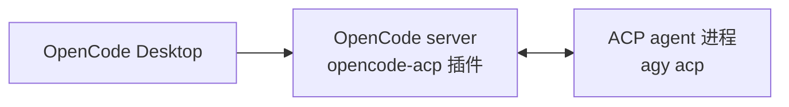

# opencode-acp

把外部 ACP agent 接入 OpenCode Desktop。选中对应的 ACP 模型后，每条消息都交给 agent 在自己的进程里执行；OpenCode 负责显示对话、思考、工具卡片、diff 和审批，并保留会话历史。

内置支持 Antigravity CLI（`agy acp`）。



## 功能

- 模型选择器列出 agent 通过 ACP 报告的全部模型（`agy` 为 11 个 Gemini / Claude / GPT-OSS 模型），选中后整轮对话由该模型执行。
- 每个模型带 thinking level 二级选择（如 Low / Medium / High / Extra），与 agent 的 `thought_level` 一一对应。
- 正文和思考按流式输出。
- 远端工具调用显示为 OpenCode 原生卡片：`bash`、`read` / `list`、`grep` / `glob`、`edit` / `write`（带 diff）、`webfetch`，其他工具使用 `acp_<name>` 通用卡。OpenCode 只渲染这些卡片，不会重复执行命令或修改文件。
- `notice` 显示为 `acp_notice` 卡片；`compaction_update` / `compaction_summary_chunk` 显示为 `acp_compaction` 卡片，并在结束时给出状态和摘要。
- Settings › ACP 的「当前会话」区块可以查看和切换 agent 报告的 mode、model_config、boolean 及其他 config option；模型和 thinking level 仍由模型选择器管理。
- Desktop 中 agent 发起的 `elicitation/create` 会创建 OpenCode 原生表单，用户填写后把结果回传给 agent；没有 Desktop 窗口时请求会被拒绝。
- 最新用户消息中的图片和音频会转成 ACP `image` / `audio` block 转发；agent 未声明对应能力时忽略并提示。
- agent 回复中的图片和音频会保存到服务器临时目录，并在正文中给出路径。
- 全局命令面板提供「导入 ACP 会话」，可以列出 ACP agent 中已有但未绑定到 OpenCode 的会话，并把历史导入为新的 OpenCode 会话。
- 审批使用原生权限卡片，可以允许一次、始终允许或拒绝。
- 会话映射保存在插件 storage 中。OpenCode server 重启后，下一轮通过 `session/load` 恢复远端上下文。
- ACP 会话标题会成为 OpenCode 标题；token 统计包含 cache 和 reasoning；上下文窗口从 agent 的 `usage_update` 学习。
- 桌面端设置页按服务器管理 ACP agent，显示启用状态和模型发现结果，并可调整日志级别。

## 前置条件

- OpenCode Desktop。插件在 server 端运行，但设置页是 Desktop 功能；web 端只在 Settings › Extensions 中列出插件，不显示插件页面。
- Desktop 只从它自己启动的本地 server 加载插件页面（Settings › ACP 和「导入 ACP 会话」命令）。连接的其他服务器只需安装插件来提供模型和 ACP RPC，它们的插件页面不会被 Desktop 加载。
- 使用 Antigravity 时，在目标服务器安装 Antigravity CLI，确保 `agy` 在 `PATH` 中，并在终端完成登录。
- 如果当前网络访问模型目录需要代理，准备好代理地址，在 agent 配置的 `env` 中传入。
- 当前实现基于 `@opencode/plugin` 2.4.1，并在同版本 OpenCode Desktop 上验证。

## 安装

插件目前以本地目录方式加载，没有发布到 npm。获取源码后，在插件目录（例如 `~/.config/opencode/plugins/opencode-acp`，也就是包含 `package.json` 的目录）安装依赖并构建 Desktop 设置页：

```bash
pnpm install --frozen-lockfile
pnpm build
```

OpenCode 会自动发现 `~/.config/opencode/plugins/` 下的插件目录。插件放在其他位置时，在 `opencode.json` 或 `opencode.jsonc` 的 `plugins` 中加入插件目录的绝对路径：

```jsonc
{
  "plugins": ["/absolute/path/to/opencode-acp"],
}
```

安装后在 OpenCode Desktop 打开 **Settings › ACP**，按下文添加 agent。远端服务器也需要安装插件；agent 的 CLI、登录和可执行文件路径以所选服务器为准。

## 使用

1. 在模型选择器中选择一个模型，需要时在旁边的二级菜单中选择 thinking level。
2. 正常发送消息。只有最新一条用户消息的文本、图片和音频会转发给 agent；OpenCode 的系统提示、历史消息、工具记录和其他附件不会发送。agent 未声明 `promptCapabilities.image` / `promptCapabilities.audio` 时，对应内容会被忽略并在回复中说明。
3. agent 自己决定调用哪些工具。工具卡和 diff 由 OpenCode 渲染，实际命令和文件操作在 agent 进程中执行。
4. 需要审批时会出现原生权限卡。卡片正文会列出 agent 提供的 ACP 选项，但按钮仍然是 OpenCode 的三选一：
   - **允许一次**：只放行当前请求。
   - **始终允许**：放行当前请求，并把请求中的命令、路径或 URL 保存为项目级规则；之后完全相同的请求不再弹卡。包含 `*` 或 `?` 的资源不会写入规则。
   - **拒绝**：结束当前 step，工具显示为已停止，整轮对话显示为已中断。

   审批卡没有单独的“取消”按钮。从外部中断整个会话时，挂起的 ACP 请求会被回复为 `cancelled`，对话正常结束。

5. 点击停止会向 agent 发送 `session/cancel`，并结束当前流。

### 模型与 thinking level

- 模型列表和每个模型支持的 thinking level 来自 agent 的 `session/new` 响应。插件在启动后用一个短会话采集，采集完成后写入缓存并刷新模型目录。
- 模型列表保存在插件 storage，后续启动先显示缓存，再后台刷新。首次运行且离线时选择器可能暂时为空。
- 可以在对话中随时切换模型或 thinking level。插件在发送下一条消息前调用 `session/set_config_option`，ACP 会话保留上下文，已经生成的内容不受影响。
- 模型旁边的 “Default” 表示不指定 variant，插件会使用该模型在 agent 中的默认 thinking level。
- 旧版本插件创建的会话保存的是 `acp-agy/default`，升级后需要重新选择模型。

### 会话与标题

- 一个 agent 只启动一个进程，被所有使用它的 OpenCode 会话共享；插件卸载或 server 退出时结束。agent 运行在独立进程组中，关闭时会一并结束它 fork 的子进程。
- OpenCode 会话与 ACP 会话的映射保存在插件 storage。server 重启后，下一轮会调用 `session/load`；加载失败时会新建 ACP 会话，并在回复中说明上下文未恢复。
- agent 通过 `session_info_update` 报告的标题优先。如果 OpenCode 已经用首条消息生成了标题，ACP 标题到达后会替换它，除非用户手动重命名过会话。

### 导入已有 ACP 会话

1. 打开全局命令面板，运行「导入 ACP 会话」。
2. 弹窗先读取所有已连接服务器上的 agent 状态，再并发读取每个运行中 agent 的会话。结果按「服务器 + 目录」分组，当前项目目录排在最前并默认展开，其余分组折叠；每组先显示 8 条，可继续展开。
3. 默认只显示当前目录（精确路径及当前项目 worktree 下）的会话，可切换到「全部目录」。已绑定且 OpenCode 会话仍存在的会话隐藏；如果对应的 OpenCode 会话已删除，绑定会视为陈旧并重新出现在列表里。
4. 列表不会启动未运行的 agent：进程已退出或已停用的 agent 只在底部显示原因。刷新只重新读取已经列出会话的 agent。
5. 选择会话后，插件会调用 `session/load` 读取 agent 侧历史，把用户消息、助手文本、思考、工具卡片、通知和压缩摘要转换成 OpenCode 会话内容，然后创建新会话并打开标签页。
6. 用户消息里的图片/音频会作为 OpenCode 原生附件导入；agent 和工具产生的图片/音频会按当前实时规则保存到服务器临时目录，并在正文中给出路径。
7. 导入后模型优先使用 ACP 会话当前模型和 thinking level；找不到时回退到该 agent 的默认模型。下一轮对话通过已有绑定继续使用同一个 ACP 会话，远端上下文不会丢失。

导入依赖 OpenCode 的实验性 session import 接口；服务器版本不支持时会在弹窗中提示。

### Token 与上下文

- prompt 响应中的 usage 会映射为 input / output、cache 和 reasoning token；如果 agent 只发送 `usage_update`，则使用其中的已用 token 作为输入。
- ACP 的累计 cost 不会换算成 OpenCode 的模型价格。
- 上下文窗口初始为 10,000,000，第一轮 `usage_update.size` 到达后更新为 agent 报告的值（`agy` 约为 1,048,576）。

## 设置页

1. 多台服务器可用时，使用右上角选择「此电脑」或目标服务器。配置保存在所选服务器上。
2. 点击「添加 Agent」。选 Antigravity 会预填 `agy acp`；选「自定义」则填显示名称、Provider ID 和可执行文件。启动参数逐项填写，需要代理时在环境变量中添加 `HTTPS_PROXY` 或 `HTTP_PROXY`。
3. 点击「保存并启用」。模型发现成功后，可以在所选服务器的模型选择器中使用该 agent。启动失败时可在对应行查看原因，并从「⋯」菜单重试。
4. 从「⋯」菜单编辑、启用、停用或移除 agent。停用会保留配置；移除会删除配置，已有对话记录会保留。
5. 页面下方的「当前会话」区块直接读取当前打开会话的 ACP 状态：可以切换 mode、model_config、agent 报告的 boolean config option 及其他 config option；模型和 thinking level 由模型选择器管理，这里不重复提供。非 ACP 会话、尚未建立 ACP 对话或 agent 不可用时，会显示对应原因。

「日志级别」下拉框对所选服务器立即生效，默认 `info`。首次打开时没有已配置的 agent；旧文件中的插件 `options` 不再生效。只在由自己或信任的管理员控制的服务器上启用此插件，添加的可执行文件会以 OpenCode server 的账号运行。

## 限制

- 模型目录需要开一个短会话向 agent 采集；agent 不支持 `session/close` 时，会在 agent 侧留下一个空会话。
- 图片和音频以 base64 内联在 `session/prompt` 中转发；图片单张上限 5 MB，音频单段上限 20 MB（按解码后的原始字节计算）。超过上限或无法识别格式的附件会被忽略，并在回复中说明。
- 是否接受图片/音频由 agent `initialize` 响应中的 `agentCapabilities.promptCapabilities.image` / `audio` 决定；未声明为 `true` 时模型不显示对应输入能力。`agy` 当前声明支持图片，不声明音频。
- agent 回复中的图片和音频会保存到服务器临时目录 `os.tmpdir()/opencode/opencode-acp/images|audio/<sessionID>/`，并在回复正文中给出绝对路径，不会内联渲染；超过上限或无法解码的内容不会保存。
- 实时工具结果中的图片/音频不会显示；导入历史时会保存工具结果里的图片/音频并给出路径。
- 导入历史依赖 OpenCode 的实验性 session import 接口，按当前 2.4.x 实现。
- 导入时用户附件会经过 server RPC 和 session import 两次传输，单次导入的附件总预算有限。
- 只针对 Desktop 验证；TUI 未适配。
- OpenCode 的 revert / snapshot 对远端 agent 的改动无效，需要撤销时使用 git。
- 插件 API 不提供表单：`elicitation/create` 只在 Desktop 中由插件窗口创建原生表单；TUI、web 或没有打开 Desktop 窗口时会返回 `decline`，agent 需要自行处理。
- OpenCode 自己的 agent、skill、MCP 和指令不会作用于远端 agent。

## 故障排查

| 现象                              | 处理                                                                                                                      |
| --------------------------------- | ------------------------------------------------------------------------------------------------------------------------- |
| 模型选择器里没有 `acp-agy` 的模型 | 首次启动后等待几秒，插件采集完模型目录会刷新；确认 `agy` 已安装且在 `PATH` 中；在设置页查看状态，或检查配置里的 `command` |
| 模型列表为空且设置页提示采集失败  | 检查所选服务器的网络和 agent 表单中的代理环境变量，然后重试                                                               |
| 第一轮卡住，约 60 秒后报握手超时  | 检查所选服务器是否能访问模型目录，必要时在 agent 表单中设置 `HTTPS_PROXY` / `HTTP_PROXY`                                  |
| 提示远端 agent 尚未登录或没有凭据 | 先在终端运行一次 Antigravity CLI 完成登录                                                                                 |
| 提示找不到可执行文件              | 安装对应 CLI，或把 `command` 改成实际路径                                                                                 |
| agent 进程意外退出                | 下一轮会自动重启；原始错误在 OpenCode server 日志的 `[acp]` 行中                                                          |
| 提示 ACP 会话不存在或已失效       | 下一轮会新建会话，历史上下文不会自动恢复                                                                                  |
| 贴图/音频后提示已忽略             | 确认 agent 声明了 `promptCapabilities.image` / `audio`，且所选模型本身支持对应输入；图片不超过 5 MB，音频不超过 20 MB     |
| 回复里提示图片/音频未能保存       | 检查服务器上 `os.tmpdir()/opencode/opencode-acp/` 是否可写，以及内容是否超过大小上限                                      |
| 导入列表为空                      | 切换到「全部目录」；确认 agent 正在运行并声明了 `session/list` 和 `session/load`，且会话的工作目录在当前服务器上存在      |
| 导入时提示不支持导入历史          | 升级服务器上的 OpenCode；`session.import` 是当前 2.4.x 的实验性接口                                                       |
| Desktop 里看不到 Settings › ACP   | 在 Desktop 自己启动的本地 server 上安装插件；Desktop 只从该 server 加载插件页面，连接的其他服务器只运行 server 端         |
| 需要更详细的日志                  | 在 Settings › ACP 将「日志级别」设为 `debug`，然后查看所选服务器日志                                                      |

## 开发

```bash
pnpm install
pnpm typecheck
pnpm build
```

`pnpm build` 生成 `dist/gui-experimental.cjs`，Desktop 通过 `package.json` 的 `./gui-experimental` 导出读取设置页。server 端入口是 `src/index.ts`，设置页是 `src/gui.tsx`，ACP 通信在 `src/acp/`。
